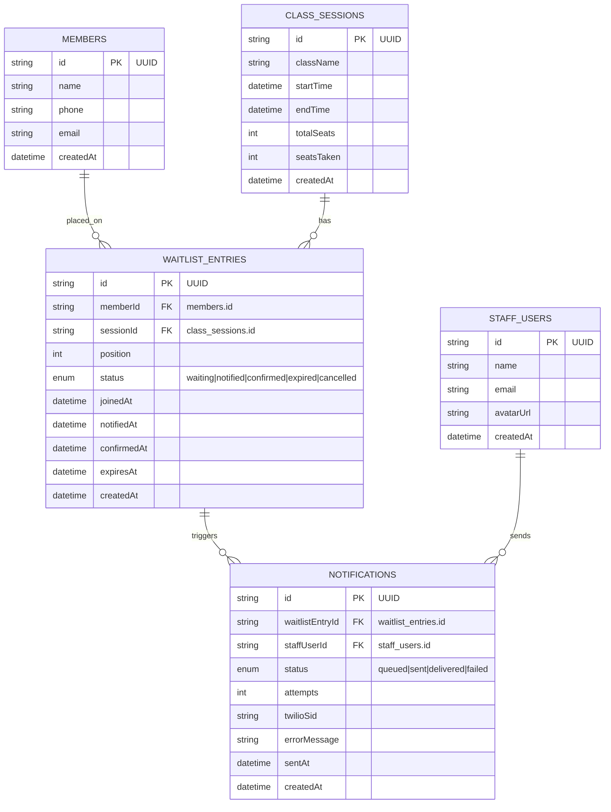

# Architecture Documentation

## Entity Relationship Diagram (ERD)



**Rationale**
- Separate `WAITLIST_ENTRIES` from `MEMBERS` to preserve historical position even if the member updates their profile.
- `NOTIFICATIONS` tracks each SMS attempt, allowing retries and audit.
- `STAFF_USERS` enables authentication/role‑based UI (future extension).

## API Contracts

| Method | Path | Request Body | Success Response | Error Response | Status Codes |
|--------|------|--------------|------------------|----------------|--------------|
| GET | `/api/sessions` | – | `[{id, className, startTime, endTime, totalSeats, seatsTaken, waitingCount}]` | `{error:{code, message}}` | 200, 500 |
| GET | `/api/sessions/:id/waitlist` | – | `[{id, member:{id,name,phone,email}, position, status, joinedAt}]` | `{error:{code, message}}` | 200, 404, 500 |
| POST | `/api/sessions/:id/waitlist` | `{name, phone, email}` | `{id, position, status:"waiting"}` | `{error:{code, message, fields:{phone:"invalid"}}}` | 201, 400, 404, 500 |
| PATCH | `/api/waitlist/:id` | `{status}` | `{id, status}` | `{error:{code, message}}` | 200, 400, 404, 500 |
| DELETE | `/api/waitlist/:id` | – | `{success:true}` | `{error:{code, message}}` | 200, 404, 500 |
| POST | `/api/sessions/:id/notify-next` | – | `{notificationId, waitlistEntryId}` | `{error:{code, message}}` | 200, 404, 409, 500 |
| POST | `/api/notifications/:id/retry` | – | `{notificationId, status}` | `{error:{code, message}}` | 200, 404, 429, 500 |
| GET | `/api/notifications` | – | `[{id, waitlistEntryId, memberName, body, status, attempts, twilioSid, errorMessage, sentAt, canRetry}]` | `{error:{code, message}}` | 200, 500 |
| POST | `/api/waitlist/:id/notify` | – | `{notificationId, waitlistEntryId}` | `{error:{code, message}}` | 200, 404, 409, 429, 500 |
| GET | `/api/dashboard` | – | `{sessions, stats:{activeWaitlists, smsSentToday, failedSms, avgWaitMinutes}}` | `{error:{code, message}}` | 200, 500 |
| GET | `/api/settings` | – | `{confirmationWindowMinutes, maxRetries}` | `{error:{code, message}}` | 200, 500 |
| PUT | `/api/settings` | `{confirmationWindowMinutes, maxRetries}` | `{confirmationWindowMinutes, maxRetries}` | `{error:{code, message, fields}}` | 200, 400, 500 |

**Standard Error Format**
```json
{ "error": { "code": "string", "message": "string", "fields": { "fieldName": "error detail" } } }
```

## Job Logic Overview
1. **Seat opens** – an internal process updates `seatsTaken` for a class session.
2. **Pick next** – the backend selects the first `WAITLIST_ENTRY` with `status = "waiting"` ordered by `position`.
3. **Send SMS** – calls `twilioMock.sendSms(to, body)`. The mock randomly fails (≈15%).
4. **Mark notified** – on success, entry status → `notified`, `notifiedAt` set, `Notification` record created with `status = "queued"`.
5. **Confirmation window** – staff can confirm the member (status → `confirmed`). If not confirmed within configurable minutes, entry becomes `expired` and the job repeats step 2.
6. **Retry** – failed notifications are retried up to 3 attempts; the same `Notification` record is re-used and its `attempts` counter incremented (see Implementation Notes).

## Design Tokens (CSS Variables)
```css
:root {
  --gray-50: #f9fafb;
  --gray-100: #f3f4f6;
  --gray-200: #e5e7eb;
  --gray-300: #d1d5db;
  --gray-400: #9ca3af;
  --gray-500: #6b7280;
  --gray-600: #4b5563;
  --gray-700: #374151;
  --gray-800: #1f2937;
  --gray-900: #111827;
  --red-600: #dc2626; /* error accent */
  --spacing-4: 4px;
  --spacing-8: 8px;
  --spacing-16: 16px;
  --spacing-32: 32px;
  --spacing-48: 48px;
  --spacing-64: 64px;
  --radius: 8px;
  --transition-duration: 150ms;
}
```

## Implementation Notes
- `DELETE /api/waitlist/:id` is a **soft delete**: the entry stays in the table with `status = cancelled` (audit trail), and queue positions are recalculated.
- Only `waiting` entries have a `position` (1..n by join time); other statuses show no position.
- **Retry budget:** the first failed SMS creates a notification with `attempts = 1`. Retrying (or notifying the same member again) re-uses that record and increments `attempts`. At `maxRetries` (default 3) the API answers `429 MAX_RETRIES` and the member is skipped (marked `expired`) by Notify Next.
- **Expiry job:** every read first checks for `notified` entries older than `confirmationWindowMinutes`. They become `expired`, positions are recalculated and the next `waiting` member is notified automatically.
- Allowed status transitions: `waiting -> notified | cancelled`, `notified -> confirmed | cancelled | expired`.
- Errors use `{ error: { code, message, fields? } }`; in the mock they are thrown as `ApiError` (`VALIDATION`, `NOT_FOUND`, `INVALID_STATE`, `SMS_FAILED`, `MAX_RETRIES`, `NO_WAITLIST`).
